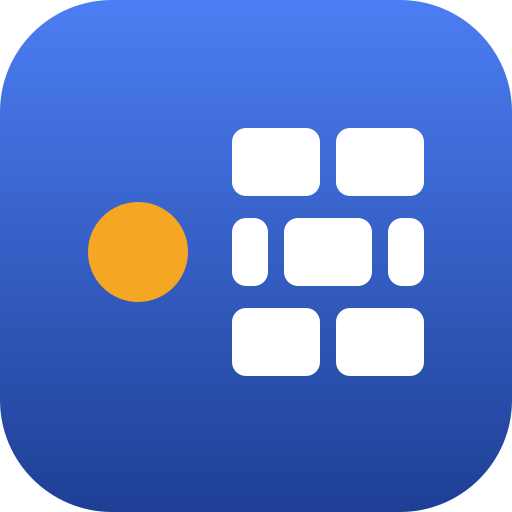
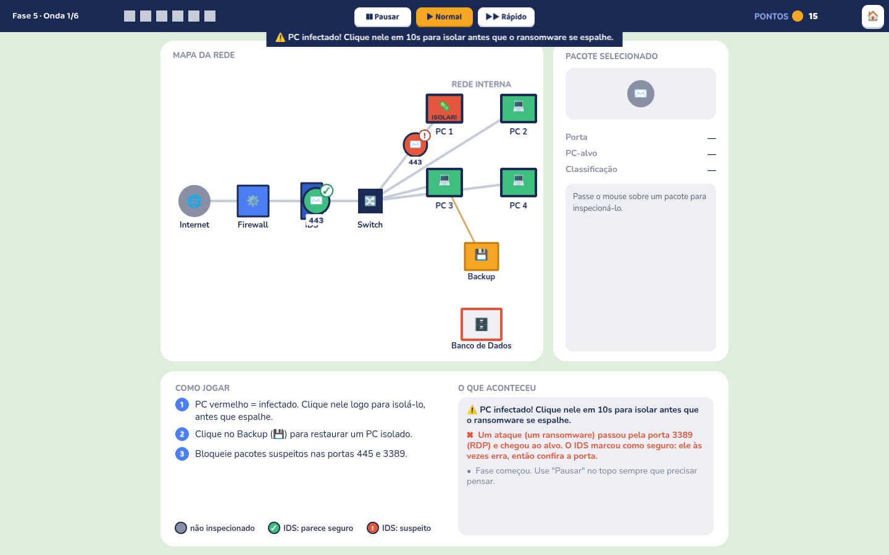
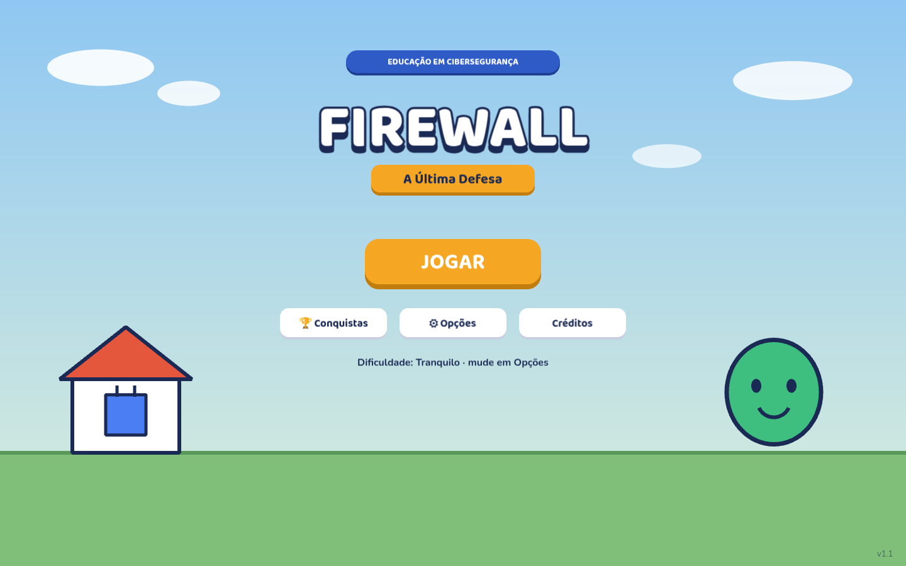
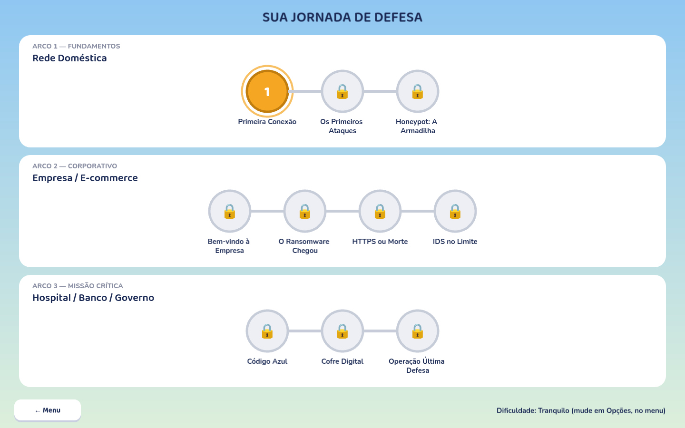
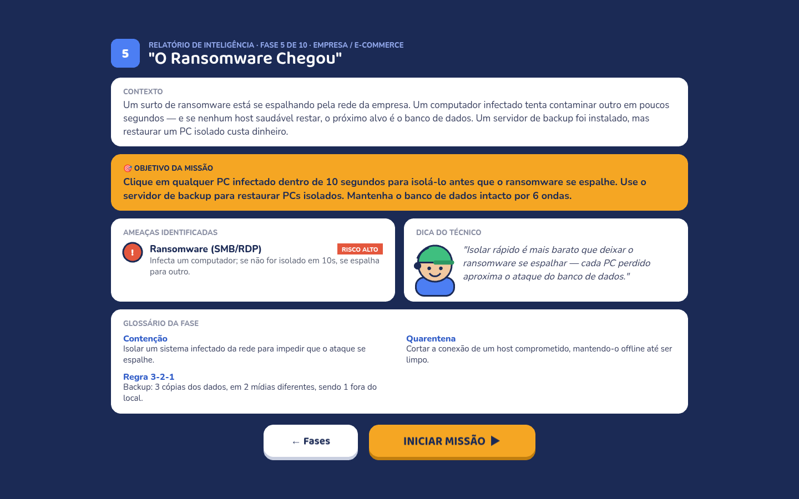
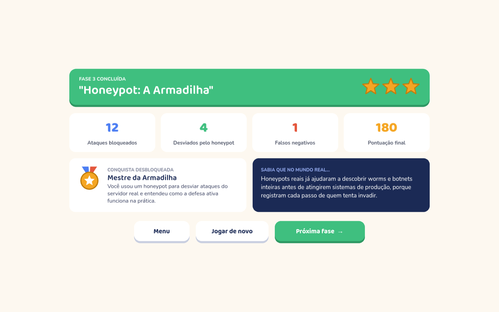

<div align="center">



# Firewall: A Última Defesa

**Learn network security by defending one.**

An educational browser tower defense: configure ports, read the IDS and contain attacks, from a home network all the way to a country's critical infrastructure.

[](https://firewall-virid.vercel.app)
[](https://github.com/Langendolff/firewall/actions/workflows/ci.yml)


-3FBF7F?style=flat-square)

[](LICENSE)

[🇧🇷 Versão em português](README.md) · [▶ Play now](https://firewall-virid.vercel.app) · [Phases](#phases) · [Run locally](#run-locally)

<br>



</div>

> The game itself is in Brazilian Portuguese.

## Why Firewall

Network security is usually taught with lists of ports and acronyms. In Firewall you
**learn by making mistakes**: a misconfigured port becomes a real attack, and the game
explains right away why that packet got through.

```
Port 3389 (RDP) left open for no reason
        ↓
✖  An attack (ransomware) got through port 3389 (RDP) and reached its target.
   The IDS marked it as safe: it is sometimes wrong, so check the port.
```

Every phase is a lesson in disguise: a **briefing** with the scenario, the threats and a
mini glossary, the playable phase, and a **debriefing** with what happened, a real-world
fact and, if things went wrong, a tip for the next attempt.

## Features

| | |
|---|---|
| 🧱 **10 phases, 3 arcs** | From a home network to a hospital, a bank and a government. Concepts come back harder as the game goes on. |
| 🎓 **Made for non-gamers** | A guided tutorial in the first phase, "how to play" steps always on screen, and a phase only starts when you press **Start**. |
| 💬 **Every mistake explained** | The "What happened" panel says why an attack got through or why a block was unfair. |
| 🐢 **Two difficulties** | **Relaxed** (default: slower, the IDS makes fewer mistakes, more time to react) and **Challenge** (the original pace). |
| ⏸️ **Pause any time** | Pause, Normal and Fast at the top of every phase, to think before acting. |
| 🎨 **Accessible** | Nothing is shown by colour alone: packets carry a ✓/! badge and ports say OPEN/CLOSED in text. |
| 🏆 **Achievements** | One per completed phase, with progress saved in the browser. |
| 📴 **No account, no server** | Runs entirely in the browser. Nothing is sent anywhere. |

## Phases

| Arc | Setting | Phases | What you learn |
| --- | --- | --- | --- |
| **1. Fundamentals** | Home network | 1 to 3 | Ports, firewall allow/block, IDS, false positives, honeypots |
| **2. Corporate** | Company and e-commerce | 4 to 7 | Segmentation and DMZ, ransomware and isolation, HTTPS and man-in-the-middle, APTs |
| **3. Critical mission** | Hospital, bank and government | 8 to 10 | Defence in depth, IoT, banking fraud, MFA, worms, supply-chain attacks |

The full teaching script, with each phase's goals, threats and concepts, is in
[`design/levels/roteiro-fases.md`](design/levels/roteiro-fases.md) (Portuguese).

## Screens

<p align="center">
&nbsp;

</p>
<p align="center">
&nbsp;

</p>

## Play

Open **[firewall-virid.vercel.app](https://firewall-virid.vercel.app)** in a desktop
browser. Nothing to install, no account. Progress is saved in the browser (`localStorage`).

## Run locally

Requirements: Node `^22.12 || ^24 || >=26`.

```sh
git clone https://github.com/Langendolff/firewall.git
cd firewall
npm install
npm run dev        # development server
npm run build      # production build in dist/
```

To open a screen directly: `?scene=Phase4`, `?scene=Briefing&phase=7` or
`?scene=Phase2&autostart=1` (skips the Start button).

## Tests

| Command | What it does |
|---|---|
| `npm run test:unit` | Vitest: integrity of the 10 phases' data, progress and difficulty |
| `npm run smoke` | build + the game boots to the menu with no errors |
| `npm run test:e2e` | build + menu, phase select, all 10 briefings, all 10 phases, the menu windows and the debriefing in a browser |
| `npm test` | everything |

Browser tests use the installed Chrome/Chromium (or `CHROME_PATH`); with neither, run
`npx playwright install chromium`. CI runs everything on every push and pull request.

**Stack:** Phaser 4 · Vite 8 · JavaScript (ES modules) · Vitest · Playwright

## License

Firewall is an educational project distributed under the [PolyForm Noncommercial 1.0.0](LICENSE).

- **Allowed without asking:** playing, studying, teaching, research, modifying, and use for personal purposes or in schools, universities, non-profits and public bodies.
- **Commercial use** (selling, including it in a paid product, course or platform, or republishing it in magazines, collections and commercial outlets) requires written permission from the author. [Open an issue](https://github.com/Langendolff/firewall/issues) or reach the author on [GitHub](https://github.com/Langendolff).

The logo and icon (`design/brand/`) are part of the project and use the same license. The
Baloo 2 and Nunito fonts come from Google Fonts under the SIL Open Font License.

---

<p align="center">Made by <a href="https://github.com/Langendolff">Lorenzo Langendolff</a></p>
