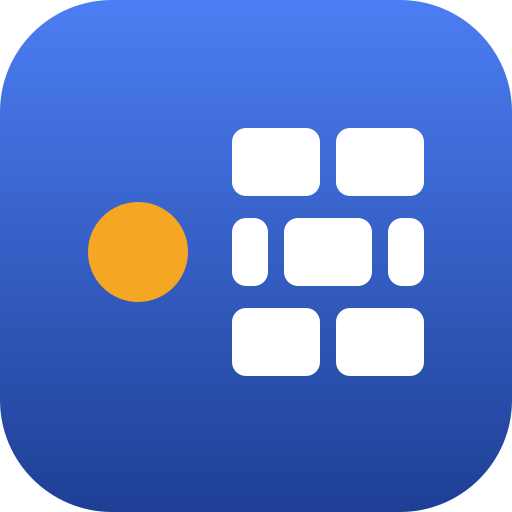
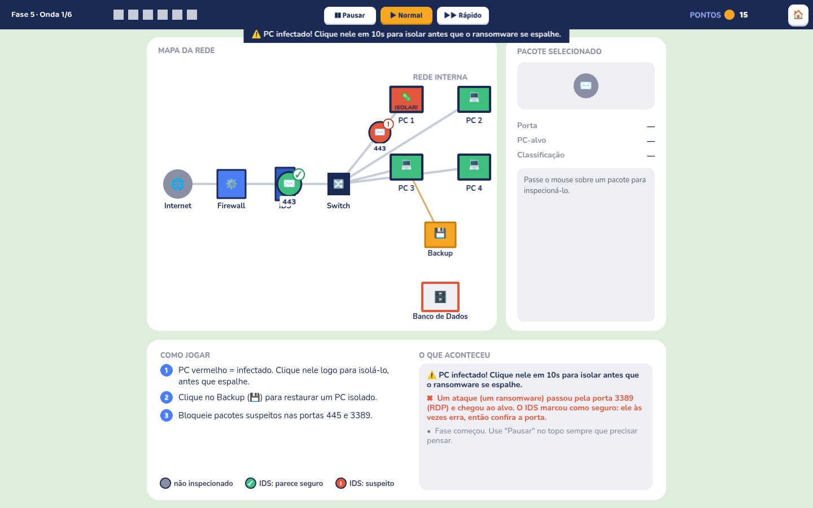
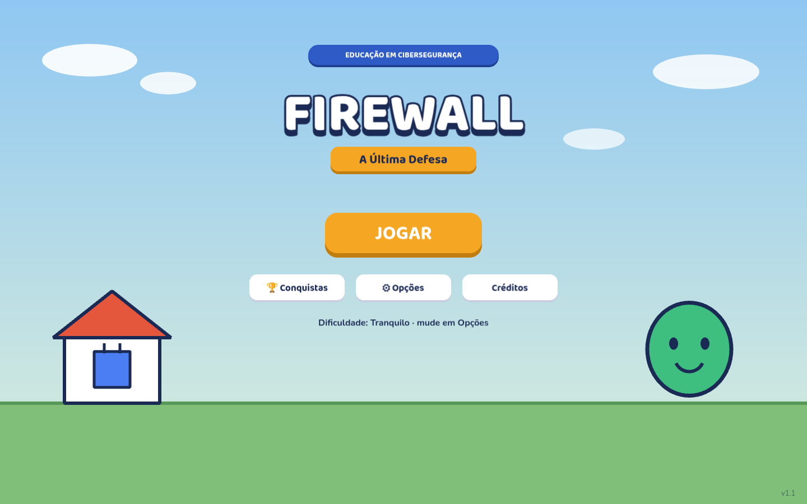
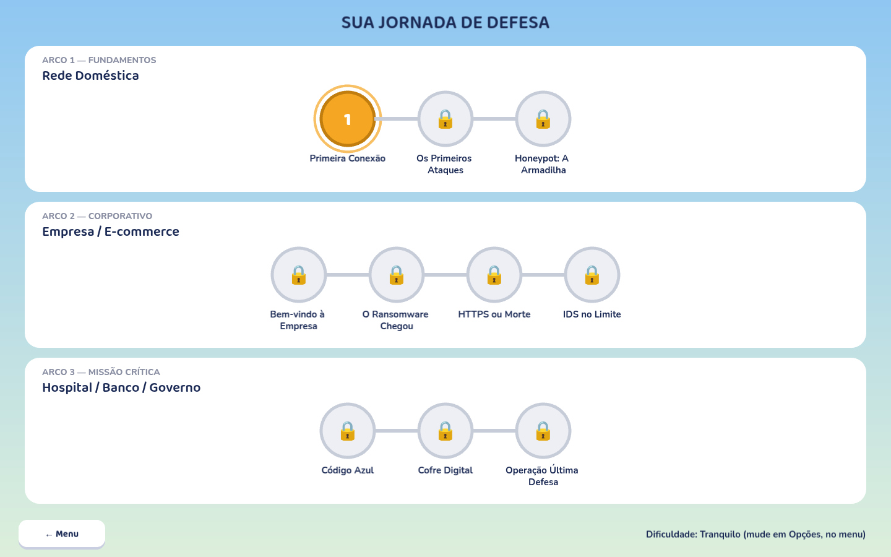
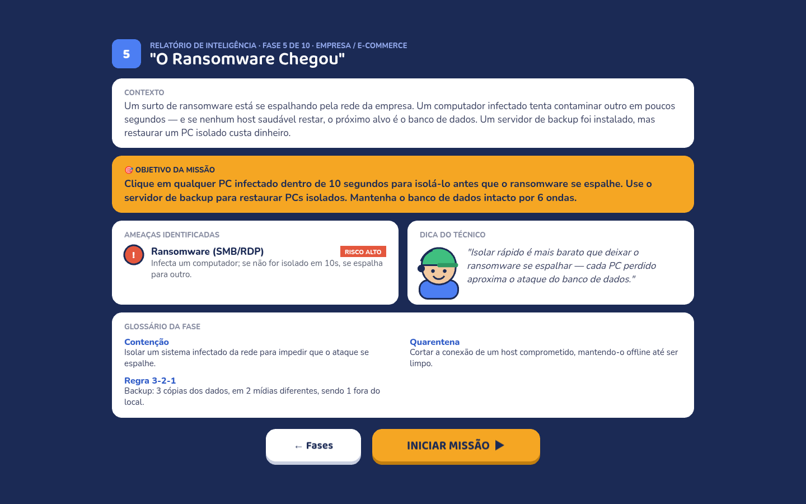
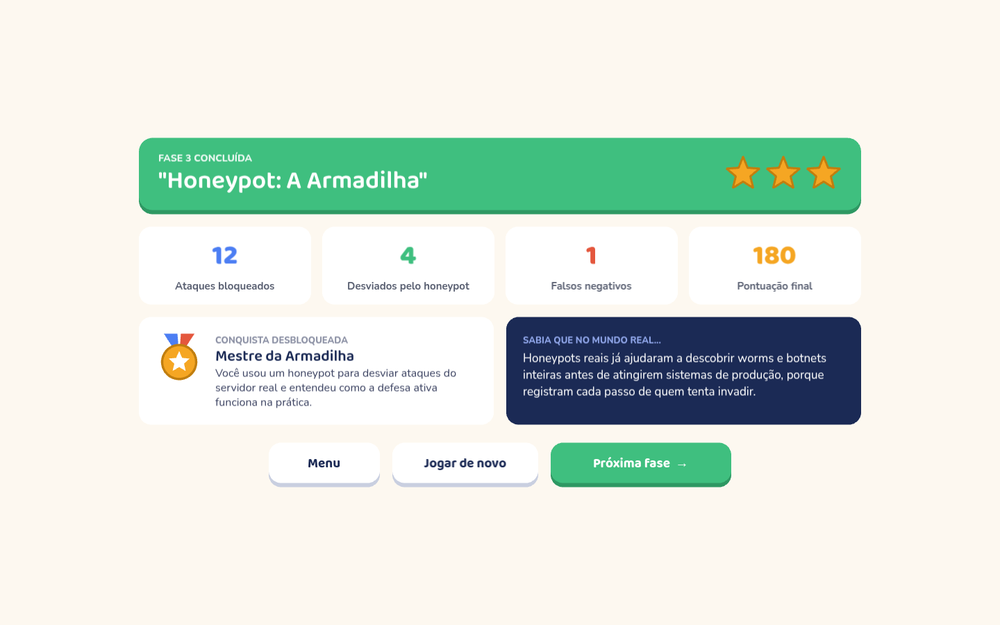
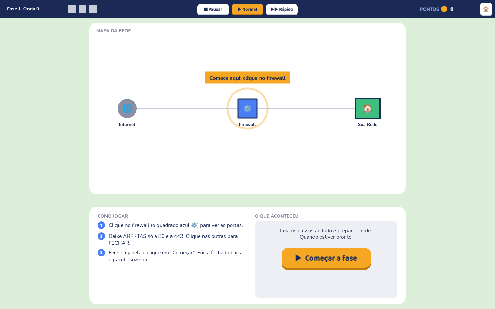

<div align="center">



# Firewall: A Última Defesa

**Aprenda segurança de redes defendendo uma.**

Tower defense educativo no navegador: configure portas, leia o IDS e contenha ataques, da rede de casa até a infraestrutura crítica de um país.

[](https://firewall-virid.vercel.app)
[](https://github.com/Langendolff/firewall/actions/workflows/ci.yml)


[](LICENSE)

[🇺🇸 English version](README.en.md) · [▶ Jogar agora](https://firewall-virid.vercel.app) · [Fases](#fases) · [Rodar localmente](#rodar-localmente)

<br>



</div>

## Por que o Firewall

Segurança de redes costuma ser ensinada com listas de portas e siglas. No Firewall você
**aprende errando**: uma porta mal configurada vira um ataque de verdade, e o jogo explica
na hora por que aquele pacote passou.

```
Porta 3389 (RDP) aberta sem necessidade
        ↓
✖  Um ataque (ransomware) passou pela porta 3389 (RDP) e chegou ao alvo.
   O IDS marcou como seguro: ele às vezes erra, então confira a porta.
```

Cada fase é uma aula disfarçada de jogo: um **briefing** com o cenário, as ameaças e um
mini-glossário, a fase jogável, e um **debriefing** com o que aconteceu, uma curiosidade
do mundo real e, se der errado, uma dica para a próxima tentativa.

## Funcionalidades

| | |
|---|---|
| 🧱 **10 fases, 3 arcos** | Da rede doméstica ao hospital, ao banco e ao governo. Os conceitos voltam mais complexos conforme o jogo avança. |
| 🎓 **Feito para quem não joga** | Tutorial guiado na primeira fase, passos de "como jogar" sempre na tela e a fase só começa quando você clica em **Começar**. |
| 💬 **Cada erro explicado** | O painel "O que aconteceu" diz por que um ataque passou ou por que um bloqueio foi injusto. |
| 🐢 **Duas dificuldades** | **Tranquilo** (padrão: mais lento, o IDS erra menos, mais tempo para reagir) e **Desafio** (o ritmo original). |
| ⏸️ **Pause quando quiser** | Pausar, Normal e Rápido no topo de toda fase, para pensar antes de agir. |
| 🎨 **Acessível** | Nenhuma informação só por cor: pacotes têm selo ✓/! e portas dizem ABERTA/FECHADA em texto. |
| 🏆 **Conquistas** | Uma por fase concluída, com o progresso salvo no navegador. |
| 📴 **Sem conta, sem servidor** | Roda inteiro no navegador. Nada é enviado para lugar nenhum. |

## Fases

| Arco | Cenário | Fases | O que se aprende |
| --- | --- | --- | --- |
| **1. Fundamentos** | Rede doméstica | 1 a 3 | Portas, firewall allow/block, IDS, falsos positivos, honeypot |
| **2. Corporativo** | Empresa e e-commerce | 4 a 7 | Segmentação e DMZ, ransomware e isolamento, HTTPS e man-in-the-middle, APTs |
| **3. Missão crítica** | Hospital, banco e governo | 8 a 10 | Defesa em profundidade, IoT, fraude bancária, MFA, worms, ataques à cadeia de suprimentos |

O roteiro pedagógico completo, com objetivos, ameaças e conceitos de cada fase, está em
[`design/levels/roteiro-fases.md`](design/levels/roteiro-fases.md).

## Telas

<p align="center">
&nbsp;

</p>
<p align="center">
&nbsp;

</p>
<p align="center">

</p>

**Menu** (dificuldade, conquistas e créditos), **Seleção de fases** por arco,
**Briefing** (contexto, objetivo, ameaças, dica do técnico e glossário), a **fase** com o
painel-guia embaixo do mapa e o **Debriefing** com estatísticas e conquista.

## Jogar

Abra **[firewall-virid.vercel.app](https://firewall-virid.vercel.app)** num navegador de
computador. Não precisa instalar nem criar conta. O progresso fica salvo no próprio
navegador (`localStorage`).

## Rodar localmente

Requisitos: Node `^22.12 || ^24 || >=26`.

```sh
git clone https://github.com/Langendolff/firewall.git
cd firewall
npm install
npm run dev        # servidor de desenvolvimento
npm run build      # build de produção em dist/
```

Para abrir direto numa tela: `?scene=Phase4`, `?scene=Briefing&phase=7` ou
`?scene=Phase2&autostart=1` (pula o botão Começar).

## Testes

| Comando | O que faz |
|---|---|
| `npm run test:unit` | Vitest: integridade dos dados das 10 fases, progresso e dificuldade |
| `npm run smoke` | build + o jogo abre no menu sem erros |
| `npm run test:e2e` | build + menu, seleção, os 10 briefings, as 10 fases, as janelas do menu e o debriefing no navegador |
| `npm test` | tudo |

Os testes de navegador usam o Chrome/Chromium instalado (ou `CHROME_PATH`); sem nenhum,
rode `npx playwright install chromium`. O CI roda tudo a cada push e pull request.

## Arquitetura

```
firewall/
├── src/
│   ├── main.js           # cria o Phaser.Game, carrega as fontes e aplica a dificuldade
│   ├── gameData.js       # todo o conteúdo e os valores de ajuste das 10 fases
│   ├── difficulty.js     # Tranquilo / Desafio
│   ├── guide.js          # painel-guia: como jogar, Começar, o que aconteceu
│   ├── progress.js       # fases concluídas (localStorage)
│   ├── ui.js, portModal.js, speedControl.js
│   └── scenes/           # menu, seleção, briefing, fases 1–10, debriefing
├── design/
│   ├── levels/           # roteiro pedagógico das fases
│   ├── gdd/              # documentos de mecânica
│   ├── ux/               # mockup visual de referência
│   └── brand/            # logo, ícone e banner (SVG)
├── docs/                 # imagens do README e referência das APIs do Phaser 4
└── tests/                # unit/ (Vitest) e integration/ (Playwright)
```

As cenas só leem `gameData.js`, então ajustar uma fase (ondas, chances, tempos, textos)
não exige mexer no código da cena.

**Stack:** Phaser 4 · Vite 8 · JavaScript (ES modules) · Vitest · Playwright

## Licença

O Firewall é um projeto educacional distribuído sob a [PolyForm Noncommercial 1.0.0](LICENSE).

- **Permitido sem pedir autorização:** jogar, estudar, ensinar, pesquisar, modificar e usar para fins pessoais ou em escolas, universidades, ONGs e órgãos públicos.
- **Uso comercial** (vender, incluir em produto, curso ou plataforma paga, ou republicar em revistas, coletâneas e veículos comerciais) só com autorização por escrito do autor. Para isso, [abra uma issue](https://github.com/Langendolff/firewall/issues) ou fale com o autor pelo [GitHub](https://github.com/Langendolff).

A logo e o ícone (`design/brand/`) fazem parte do projeto e seguem a mesma licença. As
fontes Baloo 2 e Nunito são do Google Fonts, sob a SIL Open Font License.

## Status

Versão `1.1`. As 10 fases estão completas e jogáveis do início ao fim.
Sugestões e problemas são bem-vindos nas [Issues](https://github.com/Langendolff/firewall/issues).

---

<p align="center">Feito por <a href="https://github.com/Langendolff">Lorenzo Langendolff</a></p>
